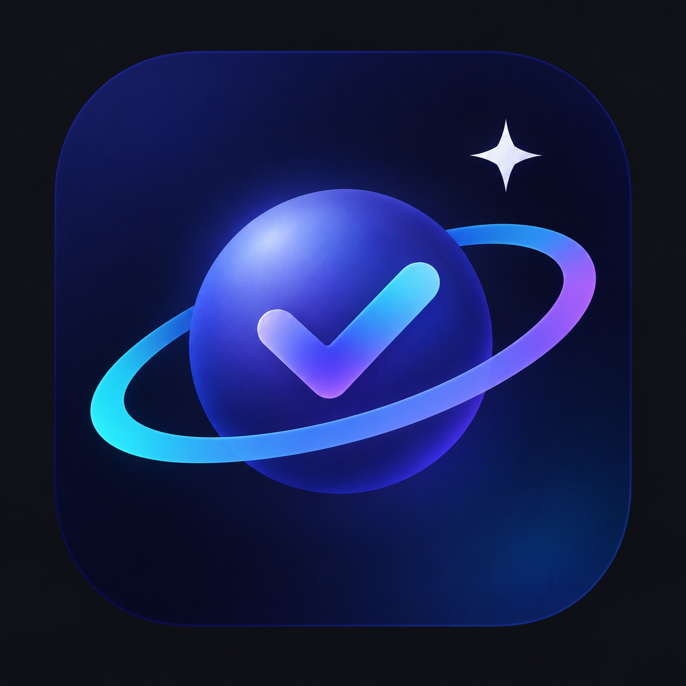

<div align="center">


# Ticka ✦

**待办 · 专注 · 每日打卡 · 星空收集**

深空玻璃拟态风格的 Android 效率应用：每完成一次专注或任务，就摘下一颗随机星星，攒满一整片自己的夜空。

[English](README_EN.md) · 简体中文

`Kotlin` `Jetpack Compose` `Material 3` `minSdk 26` `targetSdk 36`

</div>

---

## ✨ 功能

### 待办
- 增删改查：标题、备注、截止时间
- 实时倒计时，状态分色：正常（青）→ 临近（琥珀脉冲）→ 超时（红）
- **闹钟级提醒**：精确闹钟 + 闹钟铃声直鸣（绕过 ROM 渠道限制）+ 强振动 + 锁屏全屏弹出
- 快捷提前档（5分/30分/1时/1天）+ 自定义提前量（天/小时/分钟步进器）
- 长按卡片删除

### 番茄钟
- 25 分钟专注 + 5 分钟休息，渐变辉光圆环
- 专注完成自动通知（带声音）并累计 🍅

### 目标（每日打卡）
- 自定义名称、渐变配色、每周排期
- 每日打卡大按钮，详情页含**开始日期、当前连续、历史最长连续、累计完成**与 12 周热力图
- 连续天数只按排期计算，当天未打卡不断签

### 🌌 星空收集（Forest 的树 → Ticka 的星）
- 每次专注完成 / 待办首完成 / 每日打卡 → 随机摘得一颗星
- **16 种星星，四级稀有度**：稀有 50%（6 种，均分 8.3%）· 史诗 30%（5 种，各 6%）· 传说 20%（5 种，各 4%）
- 尘星、辉星、焰星、双子星、超新星、彗星、极光星、星环星、钻石星、脉冲星、星云、黑曜星、花冠星、棱星、月痕星、冰晶星 —— 多数自带闪烁/流动/旋转动效
- 星星落位防重叠；取消打卡/完成 → 星星收回；重新完成 → 原样恢复同一颗
- 星空可**左右滑动**翻看历史；达到容量自动封存开启新夜空（容量可调）；一键**导出星图图片**到相册
- 待办/目标页背景散布你收集的星星（可在设置关闭）

### 同步与数据
- **SSH/SFTP 同步**：服务器地址（含端口）+ 用户名 + 密码 + 保存路径，上传/恢复一键操作，可跨设备
- **导出所有数据**为 JSON，任意设备导入恢复
- 清空所有数据（二次确认）

### 其他
- 🌐 **应用内中英文切换**（默认中文），含通知与 Toast
- 每日结算点为**凌晨 3 点**：0:00-3:00 的打卡算前一天，熬夜不断签

## 🎨 设计

深空主题：底色 `#070714` + 星云光晕与星点、玻璃卡片、靛蓝→青主渐变 `#6366F1→#22D3EE`、霓虹辉光。设计灵感来自 [uiverse.io/galaxy](https://github.com/uiverse-io/galaxy)。

## 📥 下载

直接安装已构建好的 APK：[releases/Ticka-v0.1.0.apk](releases/Ticka-v0.1.0.apk?raw=true)（12MB，debug 签名）

或自行构建：

## 📦 构建

```bash
git clone https://github.com/Debugzzz/Ticka_DEMO.git
cd Ticka
./gradlew assembleDebug
# APK: app/build/outputs/apk/debug/app-debug.apk
adb install -r app/build/outputs/apk/debug/app-debug.apk
```

要求：JDK 17+，Android SDK Platform 36。

## 🛠 技术栈

- Kotlin 2.2 · Jetpack Compose（BOM 2025.06.01）· Material 3
- 单 Activity + 双 Tab + BottomSheet，无 Room / Hilt / 导航库
- 持久化：kotlinx-serialization JSON（原子写入）
- 提醒：AlarmManager 精确闹钟 + 前台兜底 + 开机重排；提示音 MediaPlayer 直驱闹钟通道
- 同步：JSch（SFTP）；数据导出：SAF
- 图标：Adaptive Icon（位图前景 + 单色主题层）

## 📄 数据结构

```jsonc
{
  "tasks":  [{ "id", "title", "notes", "dueAt", "remindBeforeMin", "remindAt", "completed", "pomodoros", "starId", ... }],
  "habits": [{ "id", "name", "palette", "weekdays", "createdAt", "records": { "2026-10-26": 1791... }, "starIds": { ... } }],
  "stars":  [{ "id", "kind", "source", "sourceName", "obtainedAt", "x", "y", "revoked" }],
  "archivedSkies": [{ "id", "stars": [...], "archivedAt" }],
  "settings": { "host", "username", "password", "path", "lang", "skyBackdrop", "skyCapacity", ... }
}
```

## 🗺 Roadmap

- [ ] macOS 端（设计语言一致）
- [ ] SSH 密钥认证
- [ ] 通知点击深链到对应待办

## License

MIT

---

<div align="center">
把每一天，都摘成一颗星 ✦
</div>
